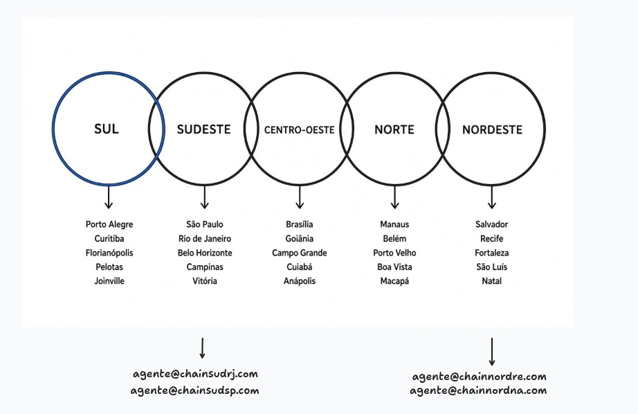

# HackBrasil Solano

Agente de WhatsApp dividido por regiões do Brasil, com memória compartilhada por região — no espírito do OpenStreetMap.

## Visão geral

O Solano é um agente no WhatsApp que atende a pessoa a partir da região onde ela está. No primeiro contato, pergunta cidade/estado e cria a conta só com **nome** e **telefone**. A partir daí, a conversa segue com o **agente regional** daquela área, que tem acesso mais fácil a informações relevantes para Sul, Sudeste, Centro-Oeste, Norte ou Nordeste.

Cada agente regional mantém uma **memória compartilhada** entre todas as pessoas da mesma região. As interações alimentam e enriquecem esse conhecimento ao longo do tempo, de forma colaborativa (inspirada no OSM).

A página pública desta proposta, para a submissão do Hack Brasil, está em [`docs/index.html`](docs/index.html).

## Como funciona

1. A pessoa envia a primeira mensagem no WhatsApp.
2. O agente pergunta de qual **cidade/estado** ela é.
3. A conta é criada com **nome** e **telefone**.
4. A conversa é roteada para o **agente da região** correspondente.
5. O agente regional responde com contexto local e, com o uso, a memória da região vai sendo atualizada.

## Memória compartilhada por região

O conhecimento não fica só na conversa individual. Tudo o que as pessoas da mesma região compartilham pode alimentar um acervo comum daquele território:

- **Por região:** cada uma das cinco regiões tem a própria memória.
- **Coletiva:** todas as pessoas daquela região contribuem para o mesmo conjunto de informações.
- **Estilo OSM:** as interações enriquecem o mapa de conhecimento local ao longo do tempo (ruas, serviços, hábitos, avisos — o que a própria região for ensinando).

Assim, quem chega depois se beneficia do que a comunidade já relatou.

## Regiões e exemplos de cidades

O Brasil é modelado nas cinco regiões oficiais. As cidades abaixo são **exemplos** (não um limite):

| Região | Exemplos de cidades |
| --- | --- |
| **Sul** | Porto Alegre, Curitiba, Florianópolis, Pelotas, Joinville |
| **Sudeste** | São Paulo, Rio de Janeiro, Belo Horizonte, Campinas, Vitória |
| **Centro-Oeste** | Brasília, Goiânia, Campo Grande, Cuiabá, Anápolis |
| **Norte** | Manaus, Belém, Porto Velho, Boa Vista, Macapá |
| **Nordeste** | Salvador, Recife, Fortaleza, São Luís, Natal |



No diagrama, cada círculo é uma região; as setas apontam para cidades de exemplo. Também aparecem contatos ilustrativos de agentes regionais, por exemplo:

- Sudeste: `agente@chainsudrj.com`, `agente@chainsudsp.com`
- Nordeste: `agente@chainnordre.com`, `agente@chainnordna.com`

## Stack / status

Em construção no **HackBrasil**.

- **Backend:** API em FastAPI, neste repositório (`backend/`), com Postgres e a extensão **pgvector**.
- **Frontend:** Next.js, em projeto separado.
- **Canal do MVP:** Telegram.
- **Banco:** conexão por `DATABASE_URL` (SQLAlchemy assíncrono + Alembic).

A visão das seções acima descreve o produto. Usuários, regiões e a memória compartilhada entram nas issues seguintes; esta etapa sobe a API, o Postgres e a extensão `vector`.

## Backend local

Pré-requisitos: Docker (com Compose), Python 3.12+ e [uv](https://docs.astral.sh/uv/).

Na raiz do repositório:

```bash
cp .env.example .env
docker compose up -d
```

O serviço `db` sobe a imagem `pgvector/pgvector` e publica o Postgres em `localhost:5432`. As credenciais padrão estão no `.env.example` (`solano` / `solano`, banco `solano`). Se mudar usuário, senha ou porta, mantenha `DATABASE_URL` alinhada com o Compose.

Depois, instale o backend, aplique as migrations e suba a API:

```bash
cd backend
uv sync --extra dev
uv run alembic upgrade head
uv run uvicorn app.main:app --reload --host 127.0.0.1 --port 8000
```

As migrations habilitam a extensão `vector` e criam o schema de saúde: usuários, unidades, guias de serviço e sugestões.

Confira o healthcheck:

```bash
curl -s http://127.0.0.1:8000/health
```

Com o Postgres no ar e as migrations aplicadas, a resposta é `{"status":"ok","database":"connected"}`. Se o banco estiver fora, a rota responde `503` com `"database":"disconnected"`.

### Variáveis de ambiente

Além de `DATABASE_URL`, o `.env.example` traz (todas opcionais, comentadas lá):

- `TELEGRAM_BOT_TOKEN` e `TELEGRAM_WEBHOOK_SECRET` — bot do Telegram e o segredo do webhook.
- `LLM_API_KEY`, `LLM_BASE_URL` e `LLM_MODEL` — o LLM do agente, por qualquer API compatível com a da OpenAI (chat completions com tools). Default: Groq com `openai/gpt-oss-120b`. Sem chave, ou se a API falhar, o bot responde pelos dados com o formatador de fallback (por palavra-chave). No plano gratuito da Groq o limite é 8.000 tokens/minuto, o que dá umas 3 a 4 perguntas por minuto.
- `ADMIN_TOKEN` — sem ele, `/admin/*` responde `503` (painel desligado).

### Dados de exemplo (seed)

O piloto é Recife-PE, com dados de exemplo (nomes e endereços fictícios — trocar pela fonte oficial da Secretaria de Saúde antes de usar em produção):

```bash
cd backend
uv run python -m app.seed data/recife_exemplo.json
```

O seed faz upsert idempotente por `external_key` — rodar de novo atualiza os mesmos registros, sem duplicar.

### Telegram

O bot é um agente: toda mensagem vai ao LLM, que usa três ferramentas (`salvar_localizacao`, `buscar_rede_de_saude`, `registrar_sugestao`, em `app/agent/tools.py`). Não há cadastro obrigatório; o telefone é opcional, pelo botão do `/start`. A conversa fica só em memória, por 30 minutos (`app/agent/memory.py`), e nunca vai para o banco.

Para testar localmente sem expor uma URL pública, use long polling (ele mesmo derruba um webhook configurado antes de começar):

```bash
cd backend
uv run python -m app.telegram.polling
```

Em produção (ou para testar o webhook), configure `TELEGRAM_WEBHOOK_SECRET` e aponte o bot para a API já no ar:

```bash
cd backend
uv run python -m app.telegram.set_webhook https://sua-url-publica.exemplo
```

A rota `POST /telegram/webhook` só aceita requisições com o header `X-Telegram-Bot-Api-Secret-Token` igual a `TELEGRAM_WEBHOOK_SECRET`; qualquer outro valor recebe `403`.

### Revisão de sugestões (admin)

Moradores podem sugerir correções conversando com o agente ("a UBS agora abre às 7h") ou pelo comando `/sugerir <texto>` — a sugestão fica `pending` e nunca é usada numa resposta do agente até ser revisada. Com `ADMIN_TOKEN` configurado:

```bash
curl -s -H "X-Admin-Token: $ADMIN_TOKEN" http://127.0.0.1:8000/admin/suggestions?status=pending

curl -s -X POST -H "X-Admin-Token: $ADMIN_TOKEN" -H "Content-Type: application/json" \
  -d '{"status": "verified"}' \
  http://127.0.0.1:8000/admin/suggestions/1/review
```

Verificar uma sugestão não edita a unidade automaticamente — alguém edita o arquivo de dados e reexecuta o seed.

Testes (o Postgres precisa estar no ar, com `alembic upgrade head` já executado):

```bash
cd backend
uv run pytest
```

Sem uv, no diretório `backend/`:

```bash
python -m venv .venv
source .venv/bin/activate
pip install -e ".[dev]"
alembic upgrade head
uvicorn app.main:app --reload --host 127.0.0.1 --port 8000
pytest
```

## Página pública

A submissão do Hack Brasil pede uma página em HTTPS, com título, que diga o que o projeto faz e para quem. Essa página é estática e fica em [`docs/`](docs/index.html): HTML, CSS e as fontes. Ela não usa o backend, não chama a API e não substitui o Next.js previsto em outro projeto.

O arquivo `docs/regioes-brasil.png` continua sendo o diagrama deste README. A landing não o embute, para não tratar os e-mails ilustrativos do desenho como canal de contato.

### Endereço previsto

No repositório público `moonixt/HackBrasil-Solano`, o GitHub Pages de projeto usaria:

<https://moonixt.github.io/HackBrasil-Solano/>

Essa URL é a previsão. Ela só passa a responder depois que o Pages estiver ativado com a pasta `/docs` como origem. Enquanto a configuração não existir, o endereço não é um site no ar.

### Como publicar só a landing

As duas formas abaixo publicam o diretório `docs/`, não o backend. Ativar o Pages não muda a branch padrão do repositório. Dá para publicar sem merge se a branch escolhida já contiver `docs/index.html`; o que falta, nesse caso, é permissão de administrador (ou *manage GitHub Pages settings*) para gravar a origem.

1. **GitHub Actions.** O workflow [`.github/workflows/pages.yml`](.github/workflows/pages.yml) envia apenas `docs/` quando `dev/moonixt` recebe push nessa pasta. Em *Settings → Pages → Build and deployment*, a origem precisa ser **GitHub Actions**.
2. **Branch e pasta `/docs`.** Em *Settings → Pages*, escolha a branch (depois do merge, `dev/moonixt`) e a pasta `/docs`. O arquivo `docs/.nojekyll` impede o Jekyll de reprocessar o HTML. Os caminhos da página são relativos para funcionar no subdiretório `/HackBrasil-Solano/`.

### Ver localmente

No mesmo prefixo que o Pages usa:

```bash
python3 scripts/preview_landing.py
```

Abra <http://127.0.0.1:8765/HackBrasil-Solano/>.

A verificação de título, seções, link do repositório, ausência de bot inventado e resolução dos arquivos sob esse prefixo:

```bash
python3 scripts/check_landing.py
```

O workflow [`.github/workflows/landing-check.yml`](.github/workflows/landing-check.yml) roda o mesmo script.

## Contribuindo / próximos passos

Este repositório começa pela ideia e pelo modelo regional. Próximos passos naturais:

- Definir o fluxo de primeiro contato (cidade/estado → conta nome + telefone).
- Implementar o roteamento para o agente de cada região.
- Desenhar a memória compartilhada por região (como as interações entram e como são consultadas).

Sugestões e PRs são bem-vindos — mantenha o escopo alinhado à ideia acima, sem inflar o produto.
